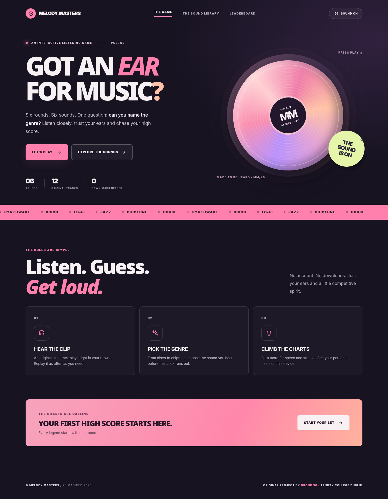
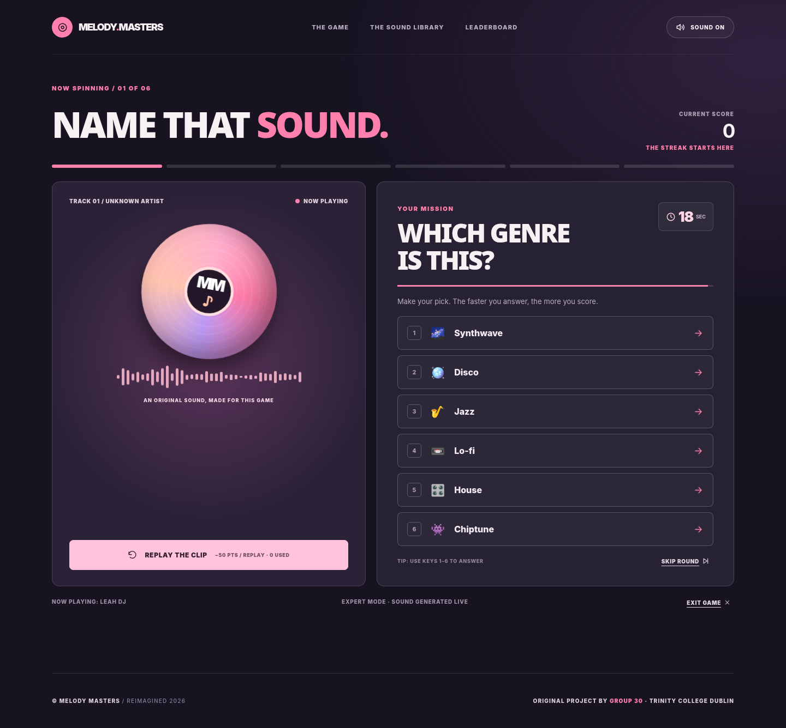

<div align="center">
  

  # Melody Masters

  **Where every note counts.**

  A playable music-genre challenge, powered by original browser-synthesised sound. Listen, identify the genre, build your streak, and climb your own leaderboard.

  **[Play Melody Masters online](https://leahweldon.github.io/Melody-Masters/)** · **[Get started locally](#quick-start)** · **[Gameplay](#how-to-play)** · **[Architecture](docs/ARCHITECTURE.md)** · **[Tests](#quality-assurance)**
</div>



## Overview

**Melody Masters** is a responsive, self-contained web game where players recognise musical genres by ear. Each session comprises six short rounds. The cues are **original compositions synthesised in real time** using the Web Audio API: there are no commercial recordings, MP3 downloads, API keys, third-party services, or external dependencies.

| | |
|---|---|
| **Playable modes** | Warm-up (25 seconds, 4 answers) and Expert (18 seconds, 6 answers) |
| **Music library** | 12 original cues across synthwave, disco, lo-fi, jazz, chiptune and house |
| **Game format** | 6 rounds; one genre represented per round |
| **Scoring** | Speed bonuses, streak rewards, replay penalties and a difficulty multiplier |
| **Leaderboard** | Local top 10, saved in the current browser via `localStorage` |
| **Technology** | JavaScript ES modules, HTML, CSS, Web Audio API; Node.js scripts for development and testing |
| **Dependencies** | Zero third-party runtime or build dependencies |

## Features

- **Complete playable loop:** difficulty selection, optional DJ name, audio playback, answer selection, instant feedback, round progression and final results.
- **Live sound synthesis:** melody, bass, rhythm and simple harmonic backing rendered directly by the browser.
- **Discover mode:** listen to short examples of all six musical styles before entering the challenge.
- **Keyboard shortcuts:** number keys for answers, `R` to replay, `M` to mute; all core actions also work via buttons.
- **Accessible interactions:** semantic controls, visible keyboard focus, reduced-motion styling and announced status changes.
- **Local-first privacy:** no account, microphone, tracking, network request or central leaderboard is required to play.
- **Responsive design:** layouts and controls designed for desktop and mobile screens.



## Quick start

**Requires:** Node.js 20+ and a modern browser with Web Audio support. **No `npm install` required.**

```bash
npm run dev
```

Open **http://127.0.0.1:4173**. Select **Let's Play**, enter an optional DJ name, and choose your difficulty. Press Play or Preview to hear the audio; sound starts in response to a user gesture to respect browser autoplay rules.

Don't open `index.html` with a `file://` URL; browsers may restrict local ES module imports. The included dev server handles this automatically.

### Production build

```bash
npm run build
```

The command writes a static, deployable site to `dist/`. You can serve it using GitHub Pages or another static hosting provider; no application server, database or package installation is needed.

### GitHub Pages deployment

A workflow is provided at [`.github/workflows/pages.yml`](.github/workflows/pages.yml). To publish it from your own repository, enable **Settings → Pages → Build and deployment → Source: GitHub Actions**. The workflow builds and deploys `dist/` when you push to `main`. Publishing availability can depend on repository visibility and GitHub plan.

## How to play

1. Choose **Warm-up** or **Expert** and optionally name your DJ profile.
2. Listen to the musical cue and identify its **genre**, not a song title.
3. Pick an answer before the timer reaches zero. Replay the sound if you need another listen.
4. Earn points for accuracy, speed and streaks; repeat listens reduce your possible score slightly.
5. Complete all six rounds and review the results. Your score can appear on the browser's local top-ten leaderboard.

Your leaderboard belongs to **this browser on this device**. Clearing site data or selecting the leaderboard's clear option removes saved scores; it does not sync across devices.

## Project structure

```text
Melody-Masters/
├── index.html                  # Web app entry point
├── src/
│   ├── main.js                 # Screens, events, focus and keyboard controls
│   ├── game.js                 # Scoring and state transitions
│   ├── catalog.js              # Six genres and twelve musical cues
│   ├── audio.js                # Real-time Web Audio synthesiser
│   ├── storage.js              # Browser-local leaderboard
│   ├── icons.js                # SVG icon helpers
│   └── styles.css              # Responsive design system
├── tests/                      # Node's built-in test runner
├── assets/
│   ├── favicon.svg
│   └── screenshots/            # Screenshots of the playable app
├── docs/
│   └── ARCHITECTURE.md         # System design and trade-offs
├── scripts/                    # Dev server, production build, checks
├── .github/workflows/          # CI and optional Pages deployment
└── package.json
```

For component responsibilities and design trade-offs, read the [architecture notes](docs/ARCHITECTURE.md).

## Quality assurance

```bash
npm test        # Unit tests for rounds, scoring, validation and leaderboard
npm run check   # Source entry points, local links and package structure
npm run build   # Reproducible static deployment output
```

The [quality workflow](.github/workflows/quality.yml) runs these checks on pushes and pull requests. Tests cover game logic and local persistence. They are not a substitute for manual testing of audio hardware, autoplay restrictions and different browsers.

## Design constraints

- **Original music, not commercial tracks:** this is an ear-training genre game, rather than a commercial song-title quiz.
- **Browser-local high scores:** there is no authentication, shared backend or multiplayer ranking.
- **Synthesised sound:** the audio uses simple oscillator-based instruments, not studio-quality recorded samples.
- **Browser audio permissions:** playback needs a user gesture; supported audio output varies by device and browser.

## Project origins and credit

The **Melody Masters** concept originated as collaborative **Group 30** coursework for **CSU33012 – Software Engineering**, Trinity College Dublin (2023–2024). **This repository contains only the new playable 2026 implementation**; the historical team submission and prototypes are retained separately in the College coursework archive, not redistributed here.

---
