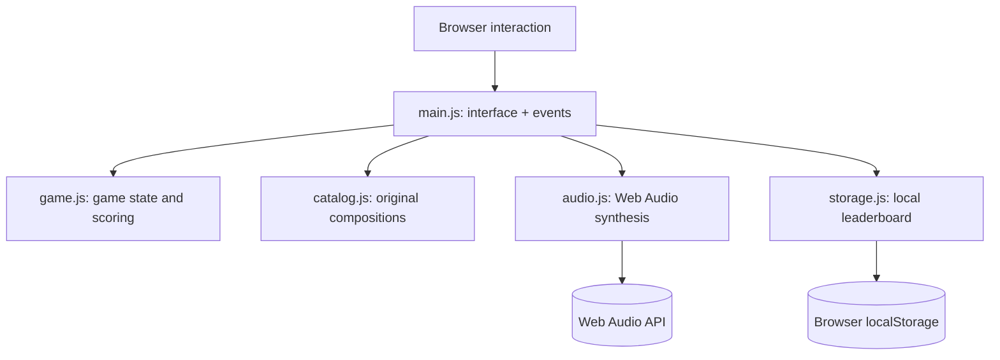

# Architecture and design decisions

[Back to the project overview](../README.md)

## System overview

### Components

- **UI and navigation — `src/main.js`:** controls screen transitions, countdown behaviour, answer interactions, keyboard shortcuts and accessibility announcements. It escapes user-supplied strings before inserting them into HTML.
- **Game state — `src/game.js`:** pure, testable game transitions, difficulty settings, round progression, streaks, replay penalties and scoring. A session includes one randomly chosen cue from each of six genres.
- **Cue library — `src/catalog.js`:** twelve original, short-form compositions (two per genre). The game asks players to identify musical genres rather than fictitious song titles.
- **Audio synthesis — `src/audio.js`:** schedules oscillators, gain envelopes, filtering and synthesised percussion in an `AudioContext`. It neither downloads recordings nor requests microphone access.
- **Local persistence — `src/storage.js`:** safely maintains a ranked top-ten list in `localStorage`, with graceful handling for blocked or unavailable storage.

## Design decisions

**No framework or third-party packages.** Native ES modules and CSS keep installation and deployment lightweight. Node.js 20+ is required only for the included local dev server, build and tests.

**No application backend.** The leaderboard is explicitly local to a browser, not a multi-user online service. A global ranking would need accounts, rate-limiting, abuse prevention and server-side score validation.

**Original synthesised audio.** A self-contained music engine avoids third-party streaming APIs, missing media files and copyrighted commercial tracks. The trade-off is a synthetic sound palette.

**Accessible by design.** Real HTML controls, keyboard access, visible focus, reduced-motion support and status announcements are provided; listening itself is inherent to the game's challenge.

**Static-first deployment.** `npm run build` outputs `dist/`, ready for GitHub Pages and other static hosting. Nothing in the playable app requires server-side execution.

## Testing

`npm test` runs the built-in Node test runner against deterministic game setup, answer locking, progression, scoring, name normalisation and local leaderboard behaviour. `npm run check` validates required files, referenced local assets, Markdown links and the dependency-free package. `npm run build` produces deployable static assets.

Audio playback, timing and responsive layouts should also be verified manually in target browsers because hardware and browser policies vary.
